<p align="center">
  <a href="https://cybedefend.com">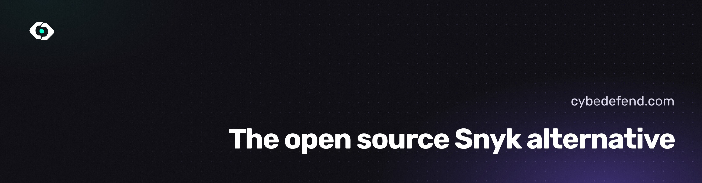</a>
</p>

<div align="center">

# CybeDefend

### Agentic AppSec and ASPM platform, for developers and their coding agents.

**Open source.** All your application security, continuously. Every scanner in one place,<br>
your policies on every commit, one dashboard for your team and your auditor, one command in your coding agent.

<br>

<a href="https://docs.cybedefend.com"></a>
<a href="https://cybedefend.com"></a>


<a href="https://cybedefend.com"></a>
<a href="https://calendar.app.google/3e6Rc9uEWqWW9nvd9"></a>


<a href="LICENSE"></a>


<br><br>

<a href="https://www.linkedin.com/company/101144768"></a>


</div>

> [!NOTE]
> Preview of the open source release planned for December 1, 2026. The install link and the Discord open on launch day.

> [!TIP]
> **New!** Paste one sentence into your coding agent. It sets up the scanners, the dashboard, the MCP server and your CI, and runs a first `/cybedefend`. [Install in one sentence](#install-in-one-sentence)

## Install in one sentence

Paste this into Claude Code, Cursor, Codex or any coding agent:

```text
Set up CybeDefend here. Follow https://cybedefend.com/install
```

Your agent installs the `/cybedefend` skill, starts the dashboard on your machine, connects the MCP server, adds the scanners to your CI and runs a first check. It asks before every step. Zero API key, zero extra model bill.

<p align="center">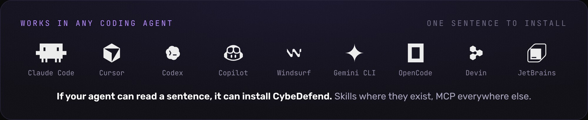</p>

## One command

```text
> /cybedefend
  ✓ code  ✓ secrets  ✓ dependencies  ✓ containers  ✓ CI          38 s
  2 issues to fix before you ship
  ✓ fixed by your agent, tests green
  SHIP
```

Type `/cybedefend` in your coding agent. It runs every scanner, fixes what blocks, and tells you if you can ship. The same check runs in CI on every pull request, and every result lands in your dashboard.

## How /cybedefend works

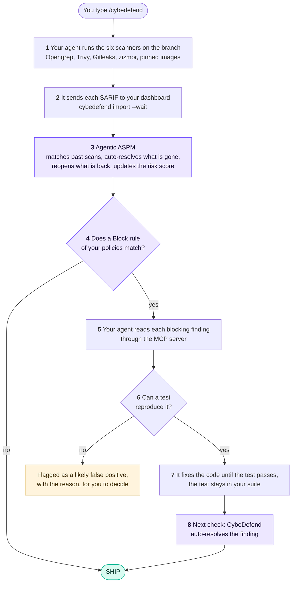

<sub>Purple steps run in CybeDefend, on your servers. The others run in your coding agent.</sub>

**What blocks, exactly.** Policies apply to an organization, a team or a project. Each rule matches findings on severity, CVSS score, CWE, OWASP category, scanner type, age or branch. A Block rule fails the check with exit code 1. A Warn rule only logs the violation.

**The same gate in CI.** `CybeDefend/appsec-scanners@v1` runs the same six scanners on every pull request and sends the results to the same dashboard, so a merge is blocked even when nobody typed `/cybedefend`.

## Scanners

**Six scanners, built in.** Pinned versions, packaged as images, ready for your CI.

<p align="center">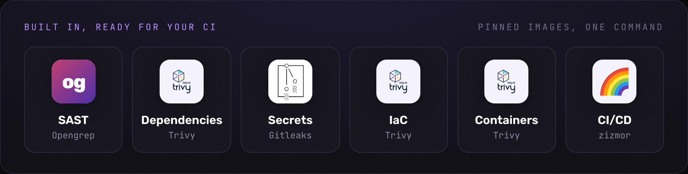</p>

**Plus every scanner that writes SARIF.** Keep the tools your teams already run and send their results to the same place, with `cybedefend import` or the API.

| | |
|---|---|
| **Code** | Semgrep, CodeQL, ESLint, Bandit, Gosec, Brakeman, PMD, SpotBugs, Ruff, Detekt, SwiftLint, .NET analyzers |
| **Dependencies** | Grype, OSV-Scanner, OWASP Dependency-Check, Snyk CLI |
| **Infrastructure** | Checkov, KICS, tfsec, Terrascan, Kubescape, Hadolint |
| **Anything else** | Any tool that writes SARIF 2.1.0 |

## Everything in the open source edition

<table>
<tr>
<td width="50%">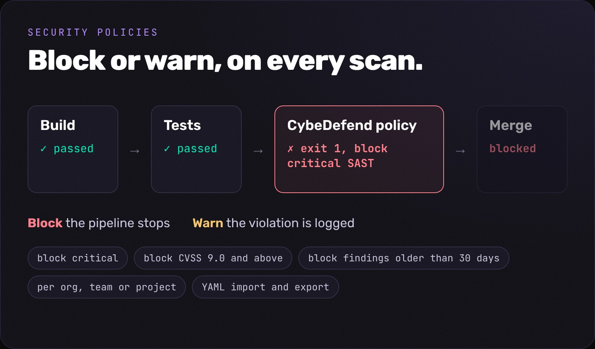</td>
<td width="50%">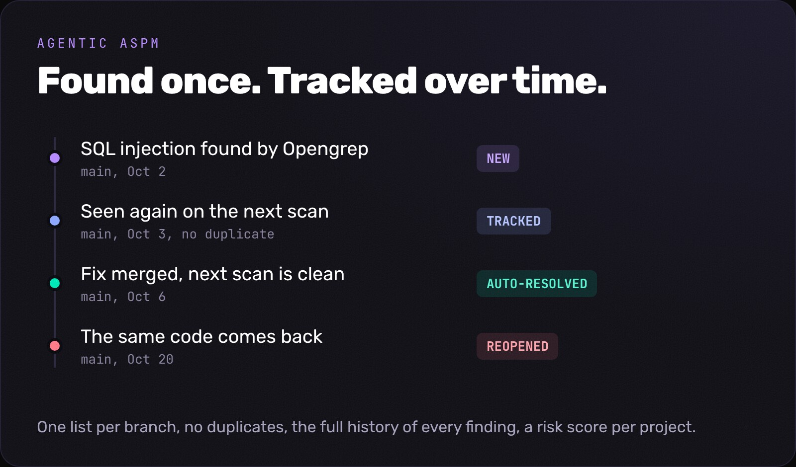</td>
</tr>
<tr>
<td width="50%">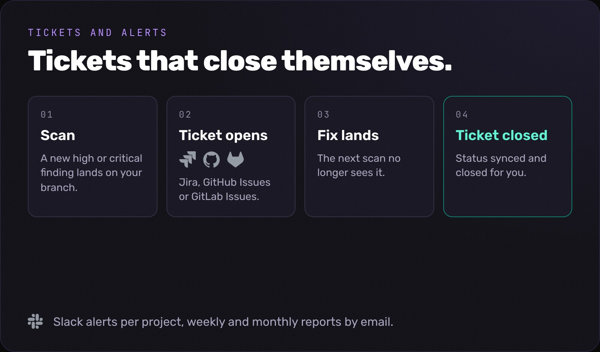</td>
<td width="50%">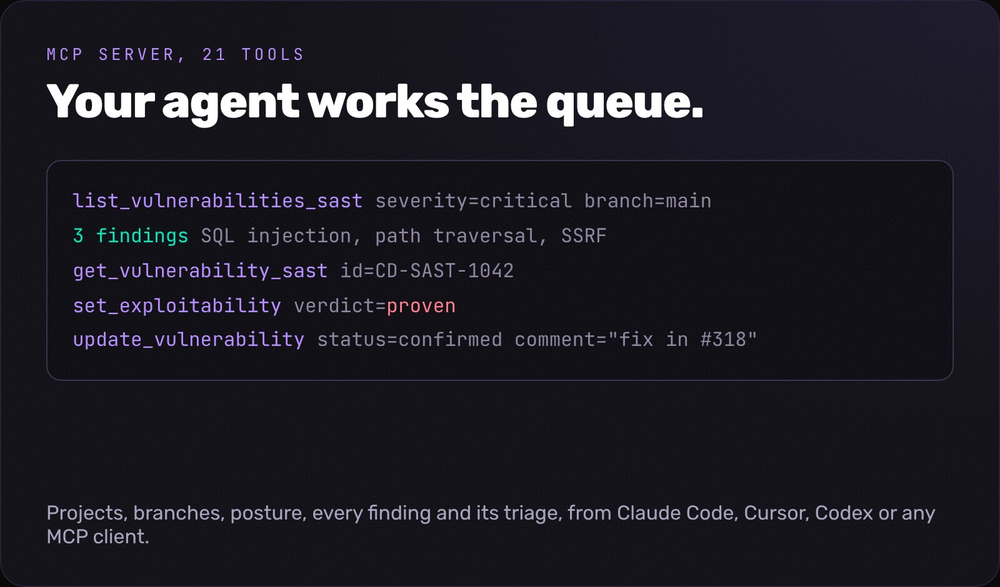</td>
</tr>
</table>

<table>
<tr>
<td width="50%">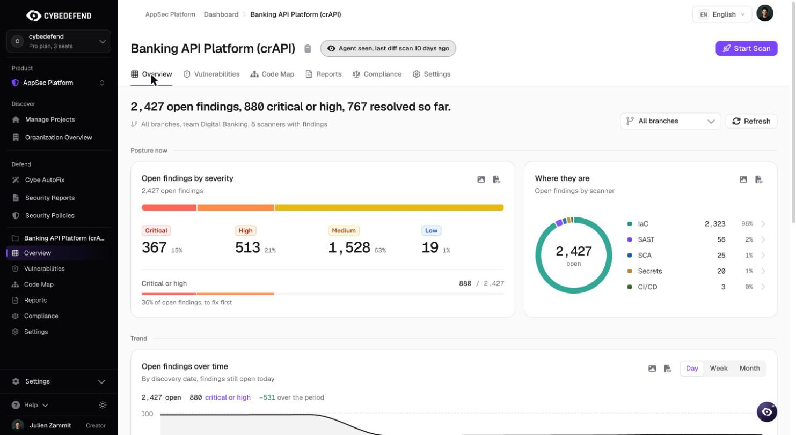<br><sub><b>Posture per project.</b> Open findings by severity and by scanner, trend over time.</sub></td>
<td width="50%">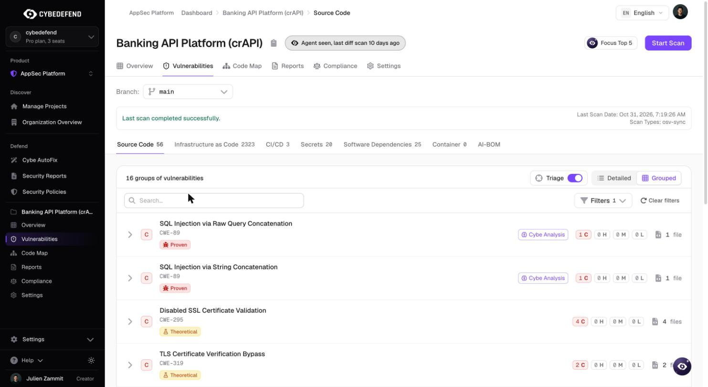<br><sub><b>One list, no duplicates.</b> Grouped by CWE, triaged, tracked per branch.</sub></td>
</tr>
</table>

<sub>Screens from today's Cloud dashboard. The open source dashboard is built on the same code, without the AI features.</sub>

<table>
<tr>
<td width="33%" valign="top"><b>Organizations, teams, roles</b><br><sub>Organization, team, project, branch. Five organization roles, four team roles, invitations.</sub></td>
<td width="33%" valign="top"><b>Risk score per project</b><br><sub>A CybeRisk level on every project, the riskiest at the top of the dashboard.</sub></td>
<td width="33%" valign="top"><b>Reports</b><br><sub>OWASP Top 10, CWE Top 25 and PDF summaries, on demand or by email.</sub></td>
</tr>
<tr>
<td valign="top"><b>GitHub and GitLab</b><br><sub>GitHub App, GitLab.com and self-hosted GitLab, with issues on both.</sub></td>
<td valign="top"><b>CI everywhere</b><br><sub>A GitHub Action and a GitLab CI template for the six scanners, a script for any other CI.</sub></td>
<td valign="top"><b>CLI</b><br><sub><code>cybedefend import</code> sends any SARIF and fails the build with <code>--break-on-severity</code>.</sub></td>
</tr>
<tr>
<td valign="top"><b>REST API</b><br><sub>Documented in Swagger, with personal access tokens.</sub></td>
<td valign="top"><b>Self-hosted</b><br><sub>Docker Compose on your servers. Your findings stay with you.</sub></td>
<td valign="top"><b>Unlimited, zero telemetry</b><br><sub>No limit on projects, users or retention. Nothing phones home.</sub></td>
</tr>
</table>

<p align="center">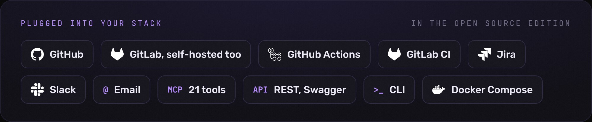</p>

## Audit-ready, all year

SOC 2 and ISO 27001 auditors ask for proof that you find and fix vulnerabilities, test your code and control your changes. CybeDefend keeps that proof while you work.

| Your auditor asks for | CybeDefend keeps |
|---|---|
| Vulnerabilities found and handled in time<br><sub>ISO 27001 A.8.8, SOC 2 CC7.1</sub> | Every finding with its dates, severity and status history |
| Secure coding and security testing<br><sub>ISO 27001 A.8.28, A.8.29</sub> | A scan on every pull request, results kept per branch |
| Security in development and change management<br><sub>ISO 27001 A.8.25, SOC 2 CC8.1</sub> | Policies in block mode in CI, on every merge |
| Evidence for the audit folder | OWASP, CWE and PDF reports, at any date |

<sub>CybeDefend does not certify you and does not write your audit report. It keeps the evidence your auditor asks for.</sub>

## Why teams switch

| | Free | Platform source |
|---|---|---|
| **CybeDefend** | Unlimited users, repos and scans, self-hosted | Open, AGPL-3.0 |
| Snyk | 100 code tests a month, 5 projects | Proprietary |
| GitHub Code Security | Public repos only, then $30 per active committer a month | Proprietary |

<sub>Figures from snyk.io/plans and the GitHub changelog of March 4, 2025, checked on November 3, 2026.</sub>

## Open source or Cloud

| | Open source | Cloud |
|---|---|---|
| Scanners, ASPM, policies, integrations | AGPL-3.0, unlimited | Managed |
| AI | Your own coding agent | Built-in AI triage and autofix pull requests |
| Rules | The six engines | About 5,300 curated rules |
| SSO, MFA, zero-day alerts, SBOM | | Included |
| Hosting | Your servers | SecNumCloud in Europe, or a US region |

<details>
<summary><b>Prefer to install by hand?</b></summary>

<br>

```bash
npx skills add CybeDefend/cybedefend
git clone https://github.com/CybeDefend/cybedefend && cd cybedefend/deploy
cp .env.example .env && docker compose up -d
```

Then open the dashboard, create your admin account and a personal token, and add the scanners to your CI with `CybeDefend/appsec-scanners@v1`. The full steps are in [install.md](install.md).

</details>

<br>

<p align="center"><sub>AGPL-3.0. The scanners keep their own licenses. Built by <a href="https://cybedefend.com">CybeDefend</a>.<br>Snyk and GitHub are trademarks of their owners. CybeDefend is not affiliated with them.</sub></p>
